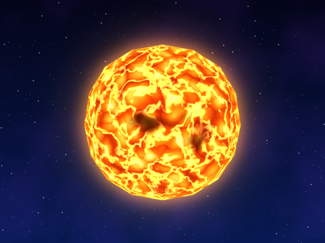
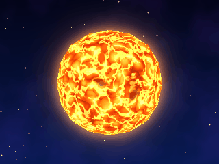
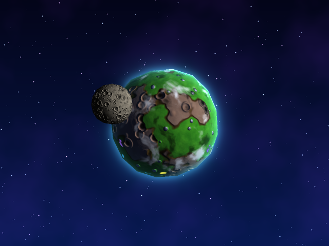
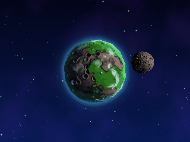
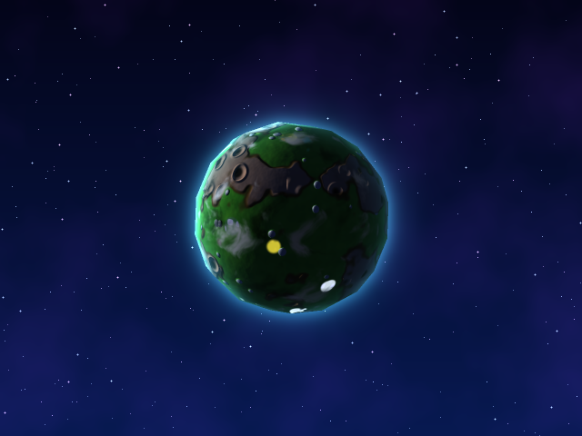
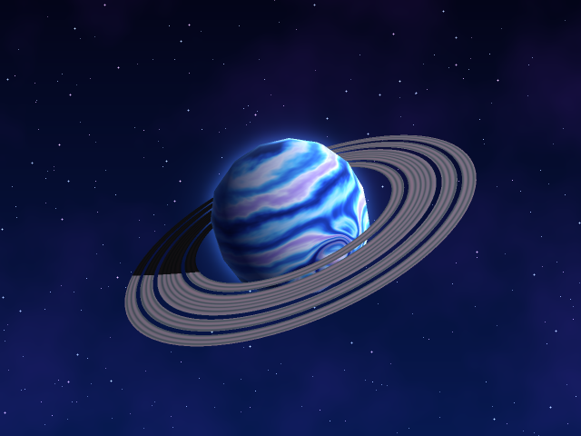
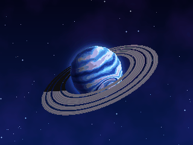
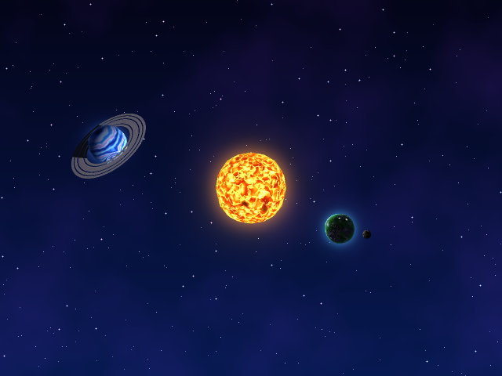
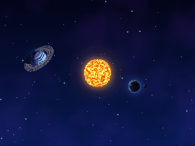

# Laboratorio: planetas y estrellas con shaders — estilo Super Mario Galaxy

Tres cuerpos celestes generados **solo con fragment shaders en CPU** sobre la **misma esfera** (`sphere.obj`), sin texturas ni imágenes.
Inspiración: el planeta de Rosalina (pasto, roca, cuevas, flores, halo celeste), los planetas helados azules y el mapa de galaxias del Mundo 2.

> Nota: el renderer (`renderer.py`) es un rasterizador en CPU con z-buffer y shaders diferidos (el shader corre una vez por pixel visible).
> Si tu clase usa otro renderer, las funciones `*_shader(F)` se portan directo: solo usan `F.n` (dirección sobre la esfera), `F.L` (luz), `F.V` (vista), `F.diff` (intensidad) y `F.t` (tiempo).

## Instalación y ejecución
```bash
pip install -r requirements.txt
python main.py                 # ventana interactiva
python main.py --shader rocky --time 3 --out screenshots/rocky.png --ssaa 2   # captura sin ventana
python main.py --shader gas --gif screenshots/gas.gif --frames 24 --size 320x240   # GIF
```
Teclas: **1** estrella · **2** planeta rocoso · **3** gigante gaseoso · **4** sistema (sol + 2 planetas orbitando) · flechas = cámara · `+`/`-` = zoom · espacio = pausa · **S** = captura.
Alternativa por código: `build("star" | "rocky" | "gas" | "system", t)` en `main.py`.

## Los cuerpos
### 1. Luma Solar (estrella) — `shaders/star.py::star_shader`
 

Sol emisivo (no usa luz externa). Capas: (1) campo de distorsión con 3 fBm animados; (2) celdas Worley deformadas = granulación convectiva (centro caliente, carriles fríos); (3) temperatura = celdas + turbulencia + variación por celda + pulso, mapeada con una rampa rojo→naranja→amarillo→blanco; (4) manchas solares con umbra y penumbra; (5) filamentos calientes con ruido *ridged*; (6) *limb darkening* y brillo de borde.
Parámetros (`P`): `speed` (velocidad de ebullición), `granule_scale` (tamaño de celdas), `warp_amount` (qué tan deformadas), `spot_threshold` (más bajo = más manchas), `flare_strength`, `corona_strength`.

### 2. Verdeluz (planeta rocoso) — `shaders/rocky.py::rocky_shader`
 
Lado nocturno (flores bioluminiscentes): 

Regiones: pasto, roca marrón con franja de tierra en el borde, cuevas (cráteres Worley), piedras redondas sobre el pasto, parches de flores moradas/amarillas/blancas (puntos con senos), estanques turquesa en las zonas bajas, nubes con sombras y halo celeste de atmósfera. La luna usa `shaders/moon.py`.
Parámetros (`P`): `cloud_cover`, `cloud_speed`, `terrain_speed`, `cloud_height`, `cloud_shadow`, `bump`, `land_scale`, `crater_scale`, `flower_scale`, `pond_level`, `night_glow`.

### 3. Aqualia (gigante gaseoso) — `shaders/gas.py::gas_shader`
 

Bandas = latitud deformada por dos escalas de ruido (bordes líquidos) combinadas con dos ondas senoidales; rampa índigo→azul→cian→blanco→lila. El fluir viene de una rotación que depende de la latitud (cizalla). Un gran vórtice rota el punto de muestreo alrededor de su centro (Rodrigues) y curva las bandas, con ojo claro y anillo oscuro. Anillos en `shaders/ring.py`.
Parámetros (`P`): `band_freq`, `warp` (qué tan líquidas), `flow_speed`, `shear`, `storm_lat/lon/radius`, `storm_twist`.

### Sistema (modo 4)
 

El sol ilumina con luz puntual a los dos planetas, que orbitan; la luna orbita al rocoso.

## Efectos por los que solicito puntos
| Efecto | Cuerpo | Archivo / función | Evidencia | Cómo funciona / parámetro |
|---|---|---|---|---|
| Material animado | Estrella, gigante gaseoso | `star.py::star_shader`, `gas.py::gas_shader` | `star.gif`, `gas.gif` | Offsets de ruido dependientes de `t`. `speed` (estrella) cambia qué tan rápido hierve. |
| Día y noche | Rocoso | `rocky.py::rocky_shader` (bloque "noche") | `rocky_night.png`, `rocky.gif` | Flores y estanques emiten luz solo donde `n·L` es bajo. `night_glow` controla el brillo. |
| Respuestas distintas a la luz | Rocoso | `rocky.py` (bloque iluminación) | `rocky.png` | Estanques con especular fuerte (`ndh**110`) y fresnel; piedras brillo suave; pasto/roca mates. |
| Nubes procedurales | Rocoso | `rocky.py::cloud_density` | `rocky.gif` | fBm con dominio deformado, rotado a otra velocidad que el terreno. `cloud_cover` ajusta la cobertura. |
| Sombras de nubes | Rocoso | `rocky.py` (bloque "nubes y sombras") | `rocky.gif` | Se muestrea la misma densidad en el punto desplazado a lo largo de la componente tangente de la luz. `cloud_height` cambia el desplazamiento. |
| Tormenta / vórtice | Gaseoso | `gas.py` (rotación Rodrigues) | `gas.png` | Giro dependiente de la distancia al centro curva las bandas. `storm_twist` cambia cuánto se curvan. |
| Bump mapping | Rocoso (y luna) | `rocky.py::terrain` + bloque bump, `moon.py` | `rocky.png` | Campo de altura (roca, cráteres, piedras) → diferencias finitas → normal perturbada. `bump` cambia la profundidad aparente. |

No implementé parallax.
Extras de la rúbrica: **anillos** en el gaseoso (`ring.py`, malla de anillos generada en `renderer.py::make_rings`, con sombra del planeta) y **luna** en el rocoso (`moon.py`, misma esfera escalada).
